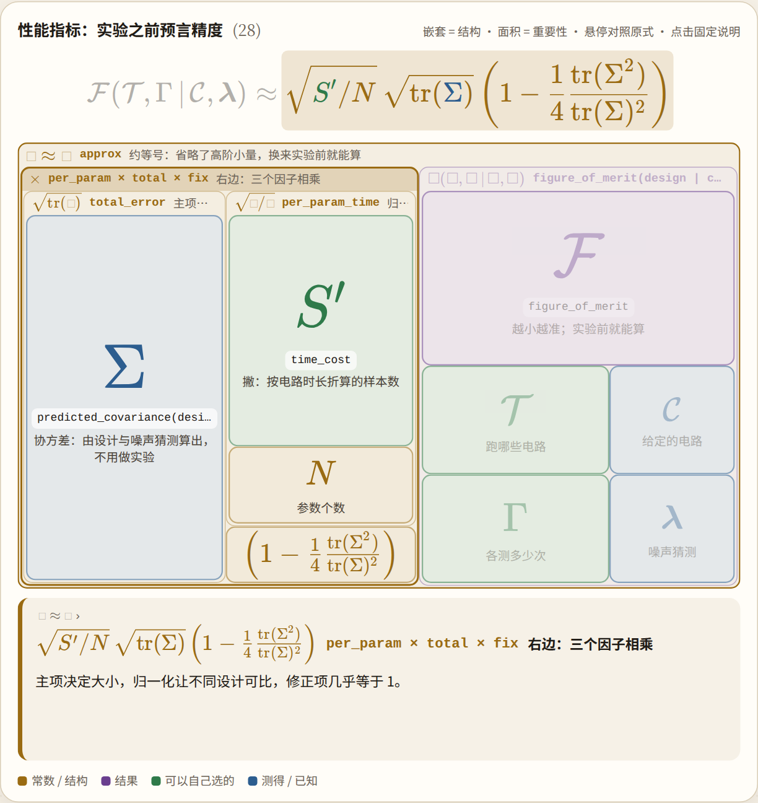
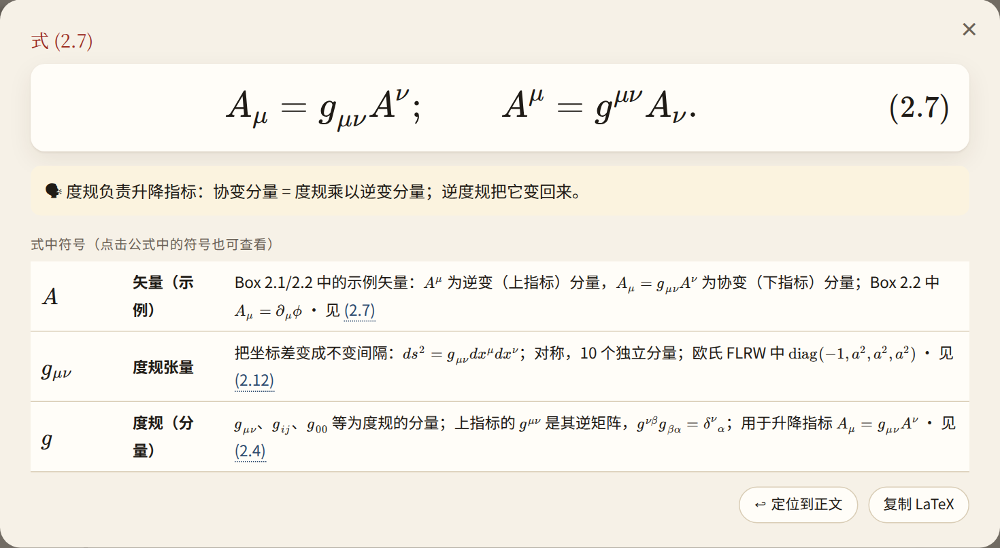
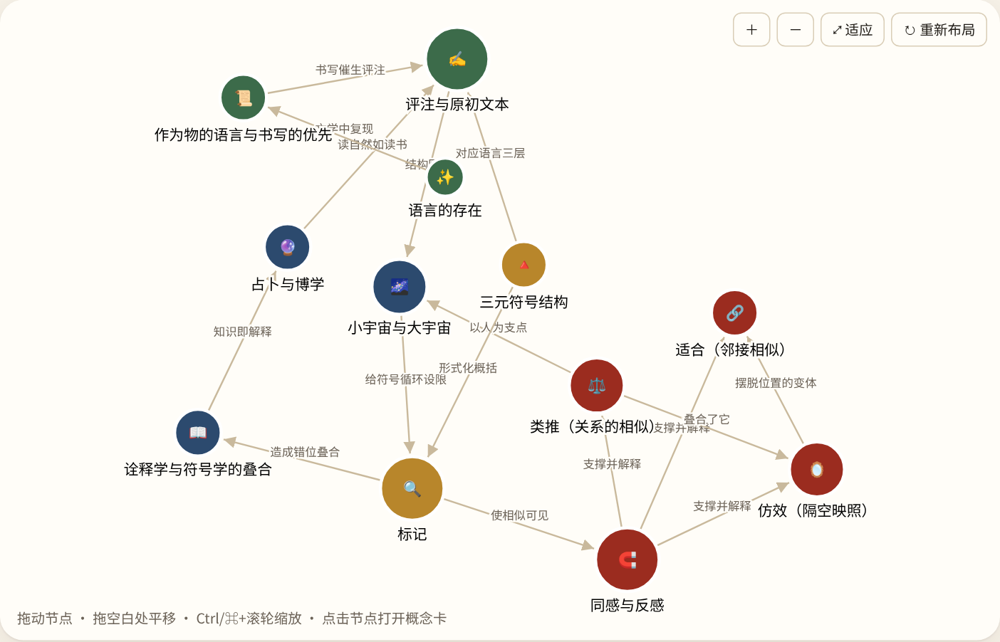
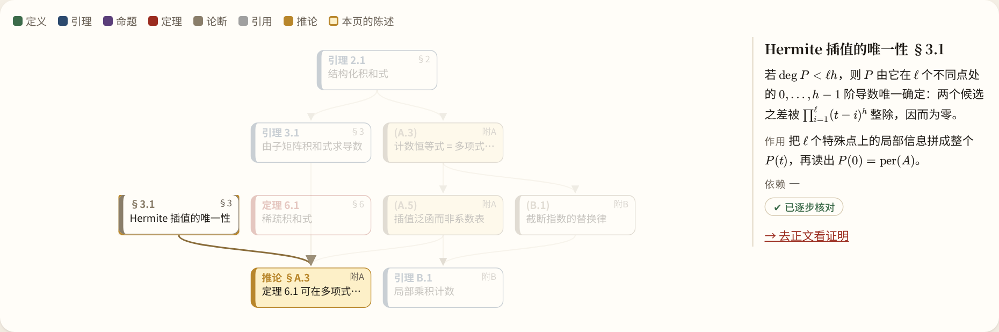
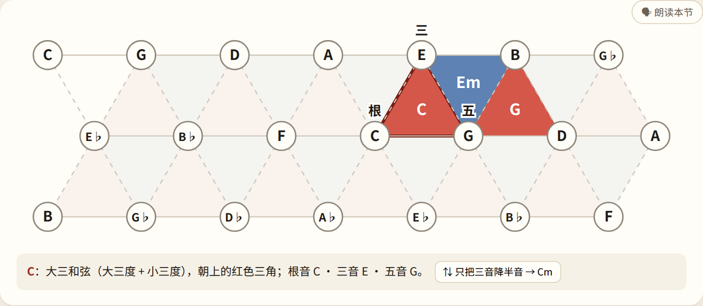
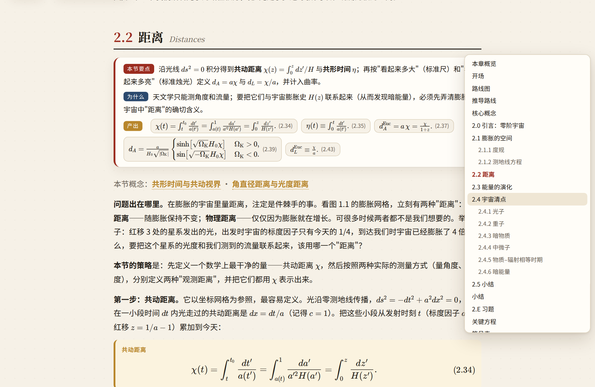

<div align="center">

# 明白.js

**把难读的书，讲明白。**

把书和论文做成交互式学习站点的框架：公式可以点开、模型可以动手调、和声可以直接听。

[在线示例](https://evoevolver.github.io/mingbai-notes/)



</div>

这个仓库只有框架，不带任何书。用它做的书库在 [mingbai-notes](https://github.com/EvoEvolver/mingbai-notes)，也是最完整的写法参考。

## 效果

<table>
<tr>
<td width="50%"><br><b>公式逐符号解读：</b>点开任一公式，看它在说什么、每个符号是什么</td>
<td width="50%"><br><b>概念关系图：</b>可以拖动和缩放，点节点打开概念卡</td>
</tr>
<tr>
<td><br><b>证明依赖图：</b>选中一条陈述，高亮它的上下游</td>
<td><br><b>可听的和声网格：</b>点三角形听和弦，点交点听单音</td>
</tr>
<tr>
<td colspan="2"><br><b>页面目录：</b>平时是右侧一列横线，悬停展开成标题面板</td>
</tr>
</table>

截图里的内容都来自 [mingbai-notes](https://github.com/EvoEvolver/mingbai-notes)。

## 组件

- **人文导读：** 核心概念卡、论证主线、关系图、例子压缩、理解自测。
- **数理教科书：** 公式放大与逐符号解读、跨章引用、推导步骤、交互绘图。
- **定理与证明：** 陈述登记表、分步证明、依赖图、可运行示例。
- **论文导读：** 缺口 → 动机 → 方案 → 结果的骨架，按重要性加权阅读，公式树图 `FormulaMap`。
- **音乐：** 可播放的谱例、键盘、和弦进行与 Tonnetz。

输出是纯静态网页，每章有独立地址，可以部署到任意静态托管。界面支持中文和英文。

## 快速开始

需要 Node.js 24 和 Python 3。

```bash
git clone https://github.com/EvoEvolver/mingbai.git
npm ci --prefix mingbai/app
```

一本书是框架之外的一个目录，至少有 `book.js` 和一个章节：

```
my-book/
  book.js
  chapters/ch01.jsx
```

```js
// my-book/book.js
export default {
  lang: "en",   // 界面语言："zh"（缺省）或 "en"
  title: "My Book", author: "Me", subtitle: "2026", intro: "What this book is about.",
  chapters: [{ id: "ch01", no: 1, title_en: "First steps" }],
};
```

```jsx
// my-book/chapters/ch01.jsx
import { ChapterPage, Block, Hook } from "@kit";

export const meta = { id: "ch01", no: 1, title_en: "First steps", one_liner: "Where it all begins." };

export default function Chapter() {
  return (
    <ChapterPage meta={meta} concepts={[]}>
      <Block id="hook" toc="Opening"><Hook title="Hello">My first page.</Hook></Block>
    </ChapterPage>);
}
```

构建并预览（`BOOK` 用绝对路径）：

```bash
cd mingbai/app
BOOK=/path/to/my-book npx vite build      # 输出到 my-book/dist
python3 -I ../serve.py /path/to/my-book 8848
```

打开 `http://localhost:8848`。

## 多本书组成书库

把若干本书放在同一个目录下，在 `<书库目录>/library/books.txt` 里按行写书目录名（决定顺序，缺省收录所有含 `book.js` 的目录）：

```bash
cd /path/to/library-root
/path/to/mingbai/build-library.sh --build   # 输出到 library/dist
```

只构建部分书：`build-all.sh book-a book-b`。书所在的目录默认是当前目录，也可以用环境变量 `BOOKS_DIR` 指定。

## 文档

| 文档 | 内容 |
| --- | --- |
| [spec/NEW_BOOK.md](spec/NEW_BOOK.md) | 接入一本新书 |
| [spec/KIT.md](spec/KIT.md) | 章节写法、组件清单、界面语言 |
| [spec/TEXTBOOK.md](spec/TEXTBOOK.md) | 数理教科书规范 |
| [spec/PROOF.md](spec/PROOF.md) | 定理与证明 |
| [spec/PAPER.md](spec/PAPER.md) | 论文导读与重要性加权 |
| [spec/AUDIO.md](spec/AUDIO.md) | 可听组件 |
| [spec/DEPLOY.md](spec/DEPLOY.md) | 路由、构建与部署 |

单章自检（构建 + 截图）用 `spec/check.sh <章节id> <书目录>`，需要先安装截图工具：`npm ci --prefix tools/pw && npx --prefix tools/pw playwright install chromium`。

## 许可证

[MIT](LICENSE)
